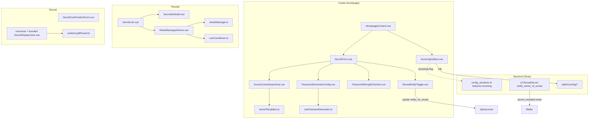

# Software Design Document (SDD)
# GoDatalize Secretos — Fork Features

| Attribute | Details |
| :--- | :--- |
| **System** | GoDatalize Secretos (fork of Onetime Secret) |
| **Release** | 0.28.0 |
| **Date** | 2026-10-15 |
| **Status** | Implemented; Vitest suites written, pending a run with dependencies installed |
| **Company site** | [https://www.godatalize.com](https://www.godatalize.com) |

---

## 1. Purpose and Principles

This document describes what the GoDatalize fork adds on top of Onetime Secret
and how each piece works. Upstream behavior (secret storage, encryption,
accounts, API) is unchanged unless stated.

Design principles:
1. **Secrets never leave the normal flow.** Fork features run in the browser or reuse existing endpoints; nothing new stores or transmits secret content.
2. **CSPRNG only** for anything random that protects data (`crypto.getRandomValues`). `Math.random` is allowed only for visual effects.
3. **Small, isolated changes** so upstream merges stay cheap: new files over edits, pure `.ts` helpers next to components.
4. **Every string through i18n** (en + es), with message syntax validated by a test.
5. **Accessibility and dark mode parity** on every component.

---

## 2. Component Map

---

## 3. Subsystems

### 3.1 Password generator
- **Randomness**: `secureRandomInt(max)` uses `crypto.getRandomValues` with rejection sampling (no modulo bias); `secureShuffle` is Fisher–Yates on the same source. At least one character from each selected set is guaranteed, then the result is shuffled.
- **Sets**: upper (26), lower (26), digits (10), symbols `!@#$%^&*()_+-=[]{}|;:,.<>?`. "Avoid ambiguous" removes `i l 1 I o 0 O | ` '`. If no set is selected, it falls back to lowercase + digits.
- **Length**: clamped in code to 6–128 (a cleared or short number input can never yield a weaker password); UI offers 6–64.
- **Strength score** (0–4), from entropy `E = L × log2(pool)`:

  | Score | Rule |
  | :--- | :--- |
  | 0 | empty or length < 6 |
  | 1 | E < 35 or L < 8 |
  | 2 | E < 55 or L < 10 |
  | 3 | E < 80 or L < 14 |
  | 4 | otherwise |

- **Memory**: settings (length + sets) saved in `localStorage` under `godatalize.passwordGenerator.v1`, validated on read, skipped if storage is blocked. The password is never stored. An explicit `initialLength` prop wins over saved settings.
- **Output**: emits `update:password` and `change`; the form submits the generated value through the normal conceal endpoint.

### 3.2 Quick templates
- 8 templates in `secretTemplates.ts`. Two kinds:
  - `fields`: translated labels → `"Username: "` lines (reads in the user's language).
  - `lines`: literal technical keys (`DB_HOST=`, `API_KEY=`), identical in every language.
- `insertTemplate(current, text, maxLength)`: empty textarea → template; otherwise append after a blank line. Result capped at `maxLength`; caret placed at the end of the template's first line.
- UI: one "Templates ▾" Headless UI menu (scales to many templates without pushing the textarea down on mobile).

### 3.3 Receipt: countdown and share message
- `useCountdown(target)` returns `remainingMs` / `isExpired`; ticks every 1 s under an hour, every 30 s otherwise; stops on unmount. `formatDuration` shows the two most significant units with `Intl.NumberFormat(..., { style: 'unit', unitDisplay: 'narrow' })`.
- `buildShareMessage({ url, expiresIn, hasPassphrase }, t)`: intro, link line ("works only once"), expiry line, and — if protected — a note that the passphrase arrives through another channel. The passphrase itself is never part of the message.
- Shortcuts: `https://wa.me/?text=…` and `mailto:?subject=…&body=…`, both URL-encoded. They only open the user's own apps; nothing is sent by the server.
- Link previews (WhatsApp, email scanners) issue GETs, which show the confirmation page and do not burn the secret.

### 3.4 Incoming secrets entry point
- Upstream `/incoming` form + `/api/incoming/*` endpoints, recipients from `INCOMING_RECIPIENT_N`, per-IP and per-recipient rate limits.
- Fork: `build_feature_flags` adds `'incoming' => features.incoming.enabled == true` (display gate only; the API enforces the flag itself). `IncomingCallout.vue` renders when the flag is true: "Send securely" link for everyone, "Copy request link" (`<origin>/incoming`) for signed-in users.

### 3.5 Reveal notification
- Upstream: `cust.notify_on_reveal`; V3 `RevealSecret#notify_owner_of_reveal` enqueues `secret_revealed` on an actual reveal (not verification), for non-anonymous owners with an email.
- Fork: `RevealNotifyToggle.vue` on the create form (fully authenticated users). Loads the account if needed, toggles via `accountStore.updateNotificationPreference`. Account-wide; the hint says so.

### 3.6 Reveal experience
- `useDecryptReveal`: phases `unlocking → decoding → done`; skipped with `prefers-reduced-motion` or values over 2000 chars; copy always uses the real value.
- Confirmation form: explicit "Reveal secret" label, one-time warning. No strength meter (removed in 0.28.0).

### 3.7 QR code
- `QRCode.toDataURL(url, { width: 320, margin: 2, color: #0A0E14 on #FFFFFF })`, generated in the browser when the modal opens; download saves the PNG.

### 3.8 Branding
- Footers show `www.godatalize.com` (`GODATALIZE_WEBSITE_URL/LABEL`); tooltip keeps "Version v…" for support.
- Brand pack `public/branding/godatalize/`; emails restyled with escaped user values.

### 3.9 i18n safety
- vue-i18n compiles messages at runtime; in production a syntax error **throws** inside render and `RouteErrorBoundary` shows "Something went wrong". `message-syntax.spec.ts` compiles all `locales/content/**` texts and fails with file + key on any error.

---

## 4. Security Review (fork scope)

| Threat | Mitigation |
| :--- | :--- |
| Weak generated passwords | CSPRNG + rejection sampling; minimum length 6 enforced in code |
| Secret leaking via helpers | Templates, share message, countdown and QR run in the browser and never include secret content; passphrase never placed in the share message |
| XSS | No `v-html` in fork components; emails escape user data with `h()` |
| Tabnabbing / referrer | External links use `rel="noopener noreferrer"` |
| Abuse of `/incoming` | Upstream per-IP and per-recipient rate limits (on by default) |
| Untrusted `localStorage` | Generator prefs validated on read; storage failures ignored |
| Production-only i18n crash | Syntax test over all translations |
| Image supply chain | Same as upstream (non-root `appuser`, `.dockerignore` excludes local config); `yq` is downloaded without checksum (upstream) |

Out of scope by decision: file attachments (rejected 2026-10-15 — Redis memory pressure, abuse risk, large backend change).

---

## 5. Configuration (Easypanel)

| Variable | Purpose |
| :--- | :--- |
| `HOST`, `SSL=true` | Public host behind Easypanel's TLS proxy |
| `SECRET` | Root secret (back it up) |
| `REDIS_URL` | Redis connection |
| `SMTP_*`, `FROM_EMAIL`, `FROM_NAME` | Email delivery (needed for incoming + reveal notifications) |
| `INCOMING_ENABLED=true`, `INCOMING_RECIPIENT_1..4` | "Send us a secret" |
| `DIAGNOSTICS_ENABLED=true`, `SENTRY_DSN`, `SENTRY_SAMPLE_RATE=1.0` | Error monitoring |
| `JOBS_ENABLED` | Leave unset: the web process sends email itself |
| `BRAND_PACK` (build arg) | `godatalize` by default |

---

## 6. Tests

| Suite | Covers |
| :--- | :--- |
| `src/tests/i18n/message-syntax.spec.ts` | Every translation compiles |
| `src/tests/composables/usePasswordGenerator.spec.ts` | Generation, sets, minimum length, saved prefs |
| `src/tests/components/PasswordGeneratorConfig.spec.ts` | UI reactivity, restored settings |
| `src/tests/apps/secret/components/form/secretTemplates.spec.ts` | Template building and non-destructive insertion |
| `src/tests/composables/useCountdown.spec.ts` | Countdown math, formatting, expiry |
| `src/tests/apps/secret/components/receipt/shareMessage.spec.ts` | Message content, share URLs |
| `src/tests/components/SecretQrModal.spec.ts` | Modal renders |
| `src/tests/apps/workspace/components/layout/WorkspaceFooter.spec.ts` | Website link + version tooltip |
| `apps/web/core/spec/views/serializers/config_serializer_spec.rb` | `features.incoming` flag |

Run: `cmd.exe /c "npx pnpm vitest run"` (frontend); `tests/lanes/run unit` (Ruby).
